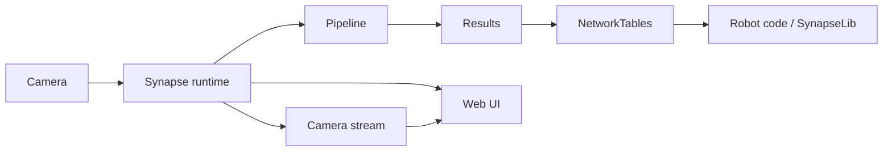
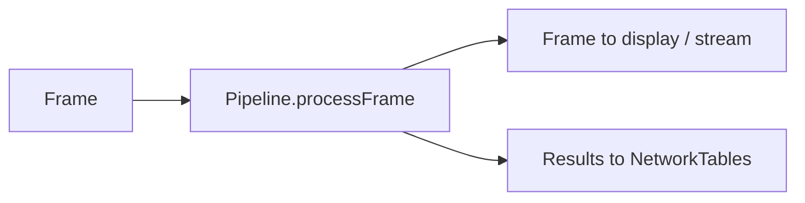
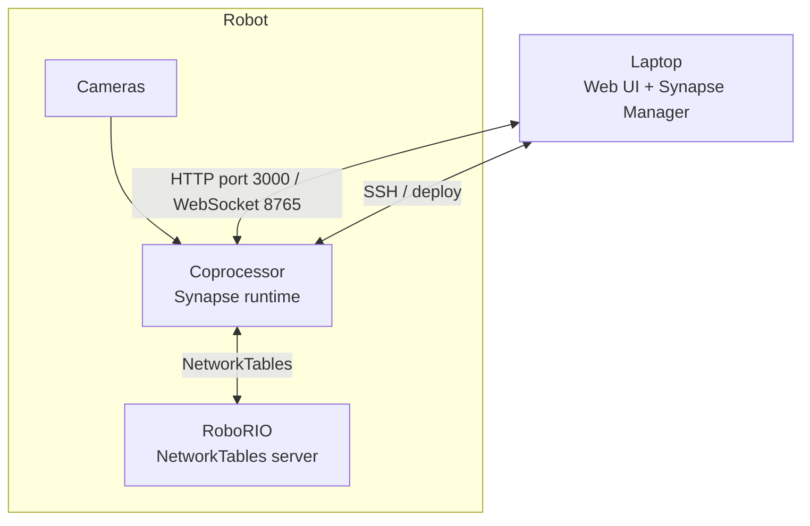

# How Synapse Works

Synapse is split into a few pieces that talk to each other over your robot's network. You do not need to understand every piece to get started, but knowing the flow makes debugging much easier.

## The big picture



1. A **camera** connected to the coprocessor produces frames.
2. The **Synapse runtime** reads those frames and passes each one to the camera's active **pipeline**.
3. The pipeline processes the frame, optionally draws on it, and produces **results**.
4. Results are published to **NetworkTables** (and to the web UI).
5. Your **robot code** reads them through **SynapseLib**.

## The runtime

The runtime is the program that runs on the coprocessor. It is installed as a systemd service called `synapse-runtime`, so it starts automatically when the device boots.

The runtime is responsible for:

- Opening configured cameras.
- Discovering pipeline classes in your project's `pipelines/` folder.
- Running the selected pipeline for each camera.
- Serving the web UI on port `3000`.
- Streaming camera feeds through CameraServer.
- Publishing results and metadata to NetworkTables.
- Saving settings when you change them in the UI.

Start it manually with the project's `main.py`:

```bash
python main.py
```

Or pass one of the runtime flags:

```bash
python main.py --sim          # use simulated cameras
python main.py --server       # start a local NetworkTables server
python main.py --headless     # skip the terminal UI
```


`--headless` only hides the terminal status display. The web UI and camera streaming still run.


## Projects

A **Synapse project** is a normal folder on your development computer. It holds your camera configuration, your pipelines, and the `main.py` that starts the runtime.

```text
my-synapse-project/
├── .synapseproject        # project name and deploy device list
├── main.py                # starts the runtime
├── pyproject.toml         # project metadata
├── pipelines/             # your custom pipeline files
├── deploy/                # extra files copied to the coprocessor
│   └── fmap.json          # optional AprilTag field map
└── config/                # created by the runtime
    ├── settings.yml
    └── camera_0/
        ├── camera_configs.yml
        └── pipeline_settings.yml
```

When you deploy, the installer:

1. Uploads your project (Python files and everything inside `deploy/`) to `~/Synapse` on the coprocessor.
2. Preserves the existing `~/Synapse/config` folder so your tuned settings survive.
3. Sets up or restarts the `synapse-runtime` service.

The `config/` folder is created by the runtime the first time it starts, not by the project creation command.

## Pipelines

A pipeline is a Python class that receives frames and returns a processed frame plus optional results. Every camera has a list of pipelines and one active pipeline at a time.



Synapse ships with:

- **AprilTag pipeline** — detects AprilTags and estimates camera/robot pose.
- **Color pipeline** — finds colored objects using HSV thresholds.
- **Calibration pipeline** — used internally by the camera calibration screen.

You can add your own by creating a `*_pipeline.py` file in `pipelines/`. Synapse finds it automatically. See [Custom Pipelines](../usage/custom-pipelines/README.md).

## Settings

Pipeline settings are defined in Python with the Settings API. Because the UI is generated from those definitions, a new setting appears in the dashboard without any UI changes.

Settings are validated when they are changed, whether the change comes from:

- The web UI.
- NetworkTables.
- Robot code through SynapseLib.

Settings are saved to `config/camera_<index>/pipeline_settings.yml`.

## Results

There are two kinds of results:

| Kind | How it is sent | Where to read it |
| --- | --- | --- |
| **Final results** | MessagePack-encoded bytes under `<camera>/data/results` | `SynapseCamera.getResults(...)` |
| **Auxiliary values** | Plain primitive values under `<camera>/data/<key>` | `camera.getDataTable().getEntry(key)`, or the UI |

Final results are compact and typed. Auxiliary values are human-readable in NetworkTables and useful for debugging.

## Robot code

Robot code never talks to the runtime directly. It talks to NetworkTables through **SynapseLib**:

```java
SynapseCamera camera = new SynapseCamera("camera0", "Synapse");
Optional<ApriltagResult> result = camera.getResults(SynapsePipelineType.kApriltag);
```

SynapseLib also lets you change settings and read latency values. See [SynapseLib](../robot-interfacing/synapse-bridge/README.md).

## Network layout



- The **RoboRIO** hosts the NetworkTables server during a match.
- The **coprocessor** connects to that server using its team number.
- Your **laptop** opens the web UI at `http://<coprocessor-ip>:3000`.

When you work without a robot, use `--server` to start a local NetworkTables server, or `--sim` to connect to the WPILib simulation server. See [Working without a robot](../usage/working-without-a-robot.md).

## Next steps

- [Installing Software](installing-software.md)
- [Quick Start](quick-start/README.md)
- [Project Management](../usage/project-management/README.md)
- [UI Interaction](../usage/built-in-pipelines-1/README.md)
