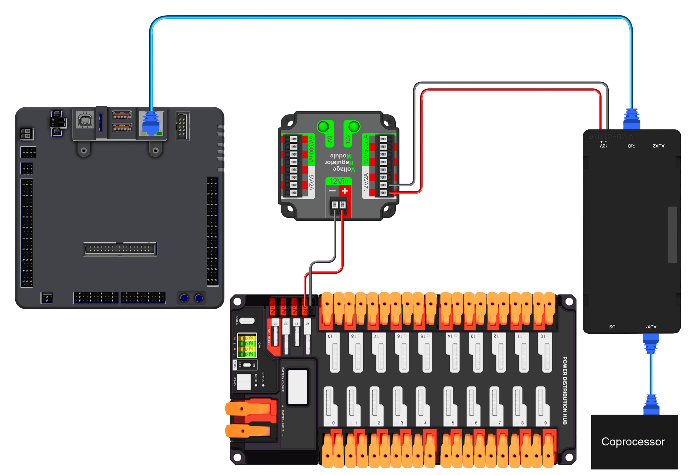
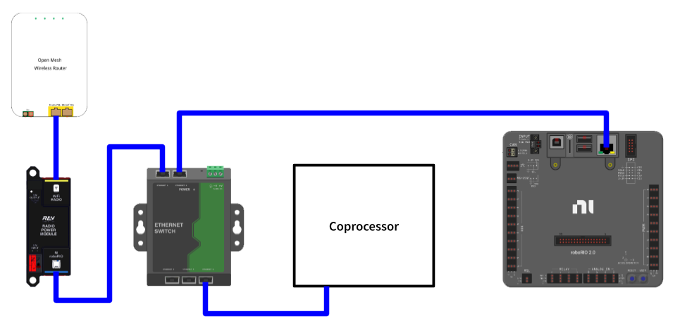

# Networking

The coprocessor needs to be on the same network as your RoboRIO, your driver station, and your development computer. This page covers the physical connections and the addresses Synapse uses.

## Physical connection


When using a Synapse coprocessor off robot, plug it into a physical router or radio, then connect your laptop to the same network. Some devices support USB "gadget mode" for sharing internet, but this is not guaranteed to work on every board.





Make sure the radio's DIP switches 1 and 2 are **off**. Otherwise the radio's PoE feature may electrically damage your coprocessor. [More info.](https://frc-radio.vivid-hosting.net/overview/wiring-your-radio#power-over-ethernet-poe-for-downstream-devices)


<figure><figcaption></figcaption></figure>



We **strongly** recommend using a network switch on your robot. The second radio port on older FRC radios is known to be unreliable and can cause connection drops during competition.

<figure><figcaption></figcaption></figure>



## Addresses and ports

Replace `<device-ip>` with the coprocessor's IP address.

| Service | Address | Notes |
| --- | --- | --- |
| Web dashboard | `http://<device-ip>:3000` | Open this in a browser |
| UI WebSocket | `ws://<device-ip>:8765` | Used by the dashboard automatically |
| Camera streams | `http://<device-ip>:118X/?action=stream` | First camera is `1180`, then `1181`, `1182`, … |
| SSH / deploy | `ssh <user>@<device-ip>` | Port `22` |
| Device discovery | UDP `45454` | Used by Synapse Manager |


Camera streams use **HTTP**, not HTTPS. If the stream does not load, check that you are using `http://` and the correct port.


The runtime also publishes its dashboard address to NetworkTables under the `web_ui` key, so robot code or a dashboard can discover it.

## Finding the device IP

On the device:

```bash
hostname -I
```

Or from your development computer, try the hostname you configured:

```bash
ping <hostname>.local
```

Synapse Manager also discovers devices automatically. See [Synapse Manager](../../usage/project-management/synapse-manager.md).

## Configuring the device network

You can set the team number, NetworkTables table name, hostname, IP mode, and network interface from the dashboard:

1. Open `http://<device-ip>:3000`.
2. Go to **Settings**.
3. Use the **Network Settings** card.

See [Settings Page](../../usage/built-in-pipelines-1/settings-page.md#network-settings) for each field.


If you set a static IP, the runtime creates a virtual interface for it so the device can keep its normal DHCP connection for updates. Make sure the static IP is on the same subnet as your robot network.


## Team number and NetworkTables

The **Team Number** setting decides which NetworkTables server the runtime connects to when it is not running in `--server` or `--sim` mode.

- On a robot, this is the RoboRIO's team number.
- If the team number is wrong, robot code will not see any Synapse data.
- Changing the team number requires a runtime restart.

The **NetworkTable** setting is the root table name Synapse publishes under. It defaults to `Synapse`. Robot code must use the same name when constructing a `SynapseCamera`.

## Working without a robot

Use one of these modes:

```bash
python main.py --server    # start a local NetworkTables server
python main.py --sim       # connect to a local simulation server
```

See [Working without a robot](../../usage/working-without-a-robot.md).
