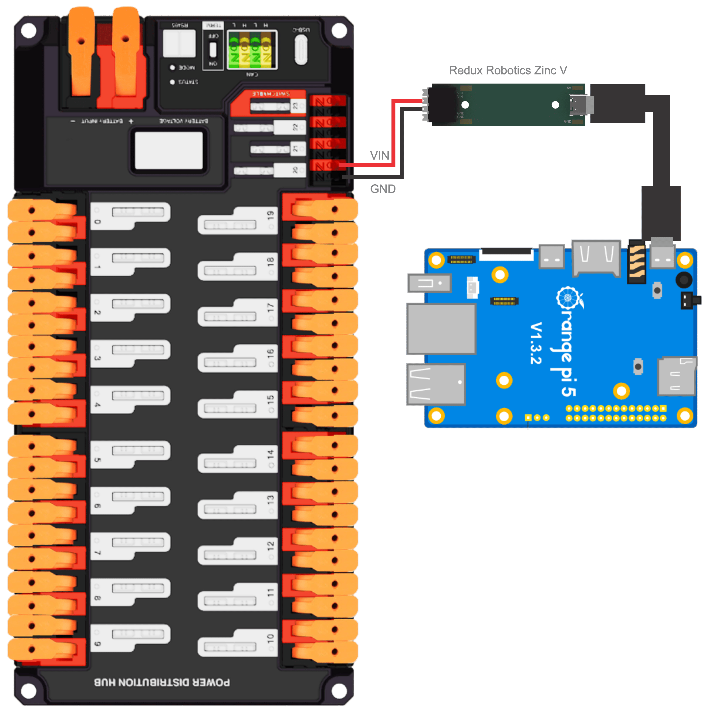
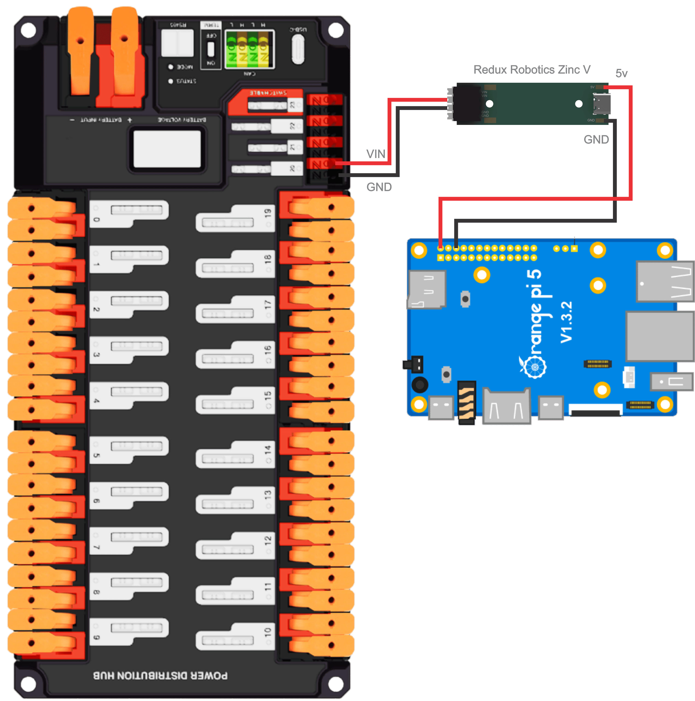
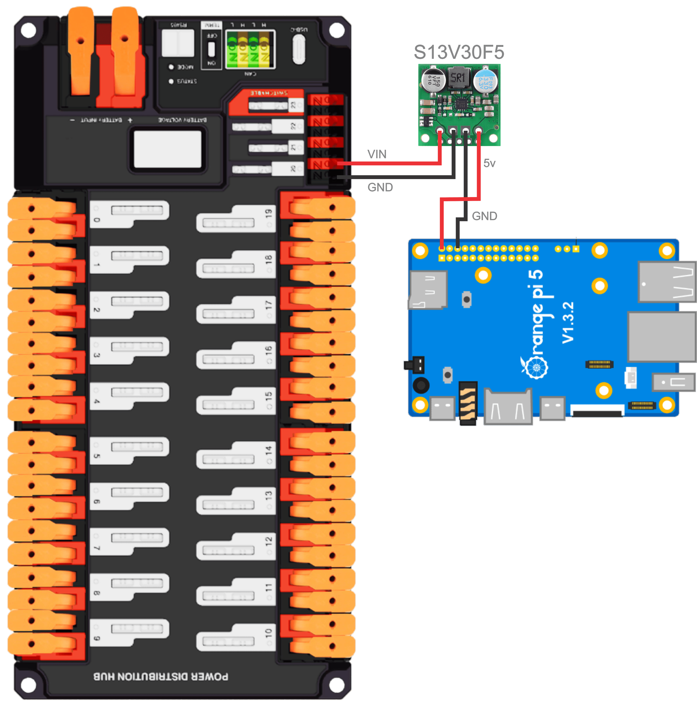
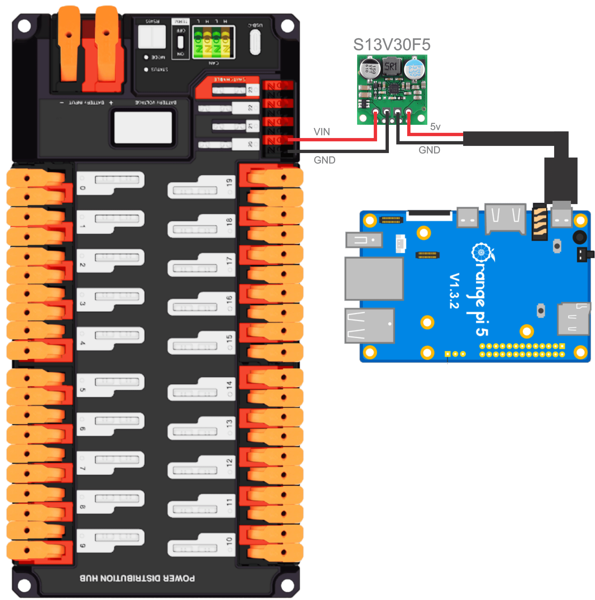
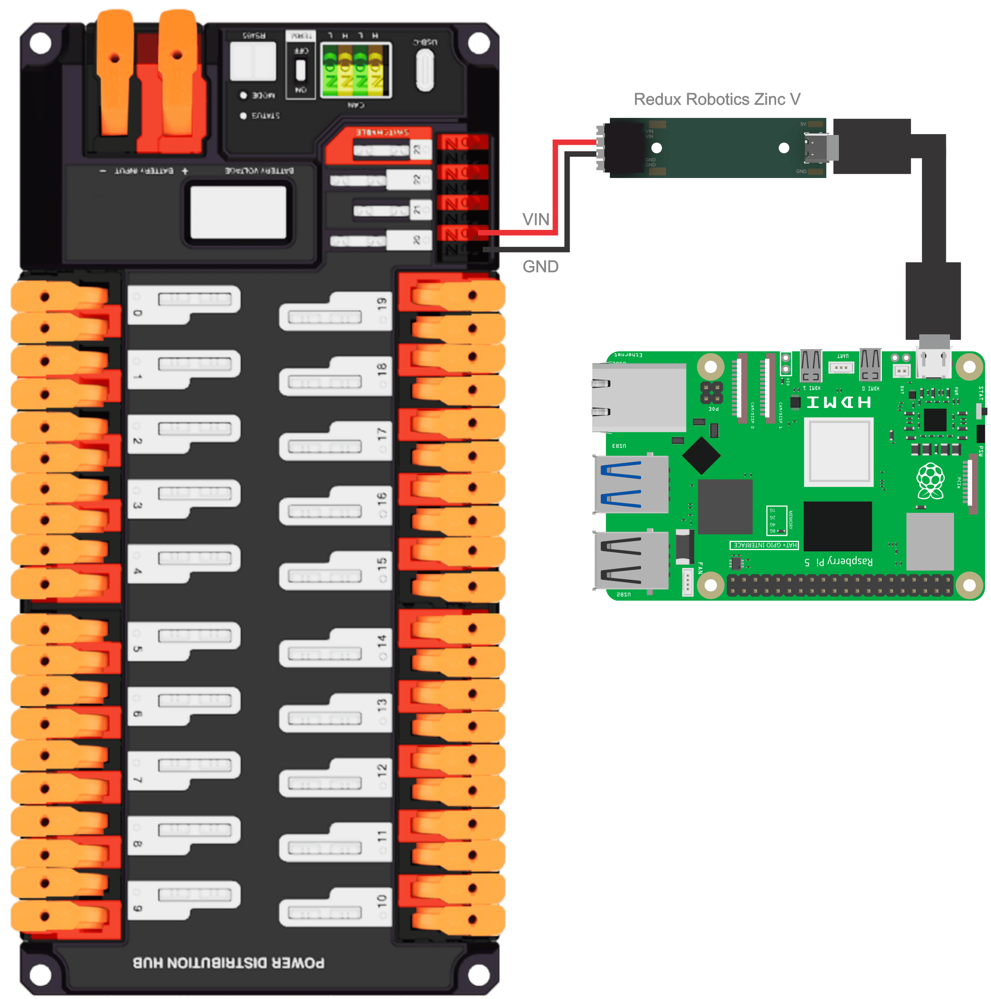
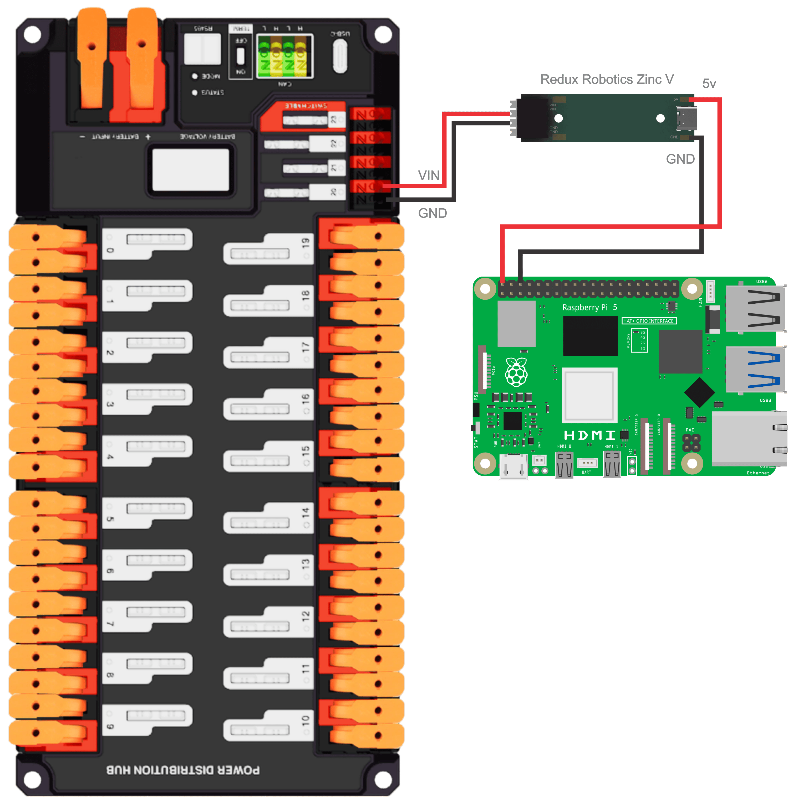

# Wiring


This page is adapted from [PhotonVision's Wiring Guide](https://docs.photonvision.org/en/v2025.3.2/docs/quick-start/wiring.html), with changes for Synapse.


## Coprocessor with a regulator

1. **Use a dedicated 5V regulator.** This prevents vision from cutting out during voltage drops when motors accelerate. Wire the regulator directly to the power distribution board.
2. **Use a locking connector or secure the plug.** Hot glue or a locking USB-C cable prevents vibration from unplugging the device.
3. **Run Ethernet** from the coprocessor to your network switch or radio.


Do not power the coprocessor from the RoboRIO's 5V rail. It cannot supply enough current, and a brownout will reboot both devices.




<figure><figcaption></figcaption></figure>



<figure><figcaption></figcaption></figure>



<figure><figcaption></figcaption></figure>



<figure><figcaption></figcaption></figure>



<figure><figcaption></figcaption></figure>



<figure><figcaption></figcaption></figure>



## Off-robot wiring

For bench testing, a wall power brick or a USB-C cable from your computer is enough.


Make sure the power supply can provide the device's rated current. Undervolting causes random reboots, Wi-Fi drops, and camera failures that look like software bugs.


## Checklist

- [ ] Regulator output is 5V and rated for the board's current.
- [ ] Regulator input is fused or protected appropriately.
- [ ] Connector is locked or glued in place.
- [ ] Ethernet cable has strain relief.
- [ ] Camera cable is fully seated and not under tension.
- [ ] The board has a heatsink or fan.
- [ ] Nothing conductive can short the board during a match.

## Next steps

- [Networking](networking.md)
- [Common Hardware Setups](common-hardware-setups.md)
- [Selecting Hardware](../hardware-selection/selecting-hardware.md)
