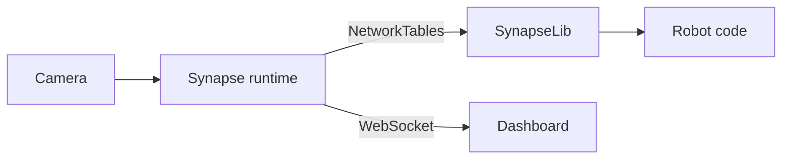

# SynapseLib: Robot Code Interface

SynapseLib is the library your robot code uses to talk to Synapse. It hides the raw NetworkTables layout behind typed classes, so you work with objects such as `SynapseCamera` and `ApriltagResult` instead of byte arrays and topic names.

With SynapseLib you can:

- Read the latest pipeline results.
- Check which pipeline is running.
- Read recording status and latency.
- Change the active pipeline.
- Read camera settings (when settings publishing is enabled).
- Convert a camera pose to a robot pose (Java).


Synapse and SynapseLib communicate over NetworkTables. Make sure the runtime is connected to the same NetworkTables server as your robot code. On a robot, that server runs on the RoboRIO. See [Networking](../../getting-started/quick-start/networking.md).


## How it fits together



The runtime publishes one NetworkTables subtable per camera under the root table (default `Synapse`):

```text
Synapse/<camera-name>/
```

SynapseLib wraps that subtable. The camera name must match the name configured in the dashboard.

## Supported languages

| Language | Package | Status |
| --- | --- | --- |
| Java | `synapse` vendordep | Available |
| Python | `synapsefrclib` (`synapselib`) | Available as an alpha |

## Pages

- [Installing SynapseLib](installing-synapse-bridge.md)
- [Getting Target Data](getting-target-data.md)
- [Robot Pose](robot-pose.md)
- [Runtime Camera Settings](runtime-camera-settings.md)
- [Custom Pipeline Data](custom-pipeline-data.md)

## A minimal example



```java
import synapse.SynapseCamera;

SynapseCamera camera = new SynapseCamera("camera0", "Synapse");
```



```python
from synapselib import SynapseCamera

camera = SynapseCamera("camera0", "Synapse")
```



## Next steps

- [Installing SynapseLib](installing-synapse-bridge.md)
- [Getting Target Data](getting-target-data.md)
- [NetworkTables API](../../additional-resources/networktables-api.md)
