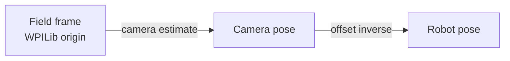

# Robot Pose

The AprilTag pipeline reports the pose of the **camera** in field space. Most robot code needs the pose of the **robot**. To convert between them, tell SynapseLib where the camera is mounted on the robot.

## The offset

`robotToCameraOffset` is a `Transform3d` from the robot frame to the camera frame:

- Translation in meters: `x` forward, `y` left, `z` up.
- Rotation in a WPILib `Rotation3d`, measured in radians.

The transform describes how to move from the robot origin to the camera:

```text
robot frame --(robotToCameraOffset)--> camera frame
```

Measure the camera's position relative to your robot's origin. The origin is whatever you use for odometry, usually the center of the robot on the floor.

## Java API

`SynapseCamera` provides three methods:

| Method | Purpose |
| --- | --- |
| `withRobotToCameraOffset(Transform3d)` | Sets the offset and returns the camera, for chaining |
| `setRobotToCameraOffset(Transform3d)` | Sets the offset |
| `getRobotToCameraOffset()` | Returns the offset, or `null` if unset |
| `estimateRobotPose(Pose3d cameraPose)` | Converts a camera pose to a robot pose |

### Configure the offset

```java
import edu.wpi.first.math.geometry.Rotation3d;
import edu.wpi.first.math.geometry.Transform3d;
import edu.wpi.first.math.geometry.Translation3d;
import edu.wpi.first.math.util.Units;
import synapse.SynapseCamera;

public class Vision {
  private final SynapseCamera camera =
      new SynapseCamera("camera0", "Synapse")
          .withRobotToCameraOffset(
              new Transform3d(
                  new Translation3d(0.35, 0.0, 1.4),
                  new Rotation3d(
                      0.0,
                      Units.degreesToRadians(20.0),
                      0.0)));
}
```

This example places the camera:

- `0.35 m` forward of the robot origin
- `0.0 m` left of center
- `1.4 m` above the floor
- pitched up by `20°`

### Estimate the robot pose

```java
import edu.wpi.first.math.geometry.Pose3d;
import java.util.Optional;
import synapse.SynapsePipelineType;
import synapse.pipelines.apriltag.ApriltagResult;

Optional<ApriltagResult> results =
    camera.getResults(SynapsePipelineType.kApriltag);

results.ifPresent(result -> {
  if (result.cameraEstimate_fieldSpace.length < 6) {
    return;
  }

  Pose3d cameraPose = result.cameraEstimate_fieldSpace3d();
  Pose3d robotPose = camera.estimateRobotPose(cameraPose);

  System.out.println("Robot: " + robotPose);
});
```

`estimateRobotPose` computes:

```text
robotPose = cameraPose.transformBy(robotToCameraOffset.inverse())
```


Set the offset before calling `estimateRobotPose`. If it is `null`, the conversion fails. Call `getRobotToCameraOffset()` if you want to check whether it is configured.


## Python workaround

The Python `SynapseCamera` does not expose `estimateRobotPose` yet. Apply the same transform yourself with `wpimath`:

```python
from wpimath.geometry import Pose3d, Rotation3d, Transform3d, Translation3d

robot_to_camera = Transform3d(
    Translation3d(0.35, 0.0, 1.4),
    Rotation3d.fromDegrees(0.0, 20.0, 0.0),
)

# camera_estimate is the Pose3d from ApriltagResult.cameraEstimate_fieldSpace3d
robot_pose = camera_estimate.transformBy(robot_to_camera.inverse())
```


`Rotation3d.fromDegrees(roll, pitch, yaw)` expects degrees. If you use the `Rotation3d(...)` constructor instead, the values are radians.


## Coordinate system



- The field frame is the standard WPILib field coordinate system.
- The field pose comes from the AprilTag field map (`deploy/fmap.json`) and the detected tags.
- The result is a full 3D pose. For a drivetrain, you usually use only `X()`, `Y()`, and `rotation().Z()`.

## Using the pose in robot code

A single camera estimate can be noisy. Common approaches:

- Reject results with a high `reprojection_error`.
- Reject results with few tags or tags far away.
- Fuse the pose with odometry using a pose estimator.
- Average multiple cameras.

The `stick_to_ground` AprilTag setting flattens the estimated camera pose to `z = 0` and zeroes roll and pitch. Enable it if you only care about the robot's 2D pose.


`cameraEstimate_fieldSpace` is published only when the AprilTag setting `publish_camera_field_pose` is enabled. That setting is on by default.


## Next steps

- [Getting Target Data](getting-target-data.md)
- [Apriltag Pipeline Settings](../../usage/built-in-pipelines/apriltag-pipeline/apriltagpipeline-settings.md)
- [Simulation](../../usage/simulation.md)
