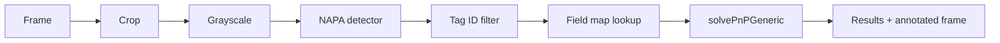

# Apriltag Pipeline

## What are AprilTags?

AprilTags are square fiducial markers with a unique black-and-white pattern. Each tag has an ID, so a camera can tell exactly which tag it is looking at. Unlike QR codes, AprilTags are designed for robotics, where fast detection and precise 3D pose estimates matter.

In FRC, AprilTags are fixed to the field. If the robot knows where each tag is, and sees one or more tags, it can estimate its own position.

Common uses:

- Robot localization and pose estimation.
- Aiming at a scoring location.
- Measuring distance and angle to a target.
- Aligning to a field element.

## How the pipeline works

For every frame, `ApriltagPipeline`:

1. Applies the configured crop region.
2. Converts the image to grayscale.
3. Runs the **NAPA** AprilTag detector to find tag corners and IDs.
4. Filters detections by `tag_filter` before any markers are drawn or poses are estimated.
5. Looks up each remaining tag's known field pose in `deploy/fmap.json`.
6. Uses OpenCV `solvePnPGeneric` with the camera matrix, distortion coefficients, and tag size to estimate the camera pose in field coordinates. A single tag is solved with `SOLVEPNP_IPPE_SQUARE`; multiple tags use `SOLVEPNP_ITERATIVE`, and the solution with the lowest reprojection error is kept.
7. Draws detection markers for the remaining tags on the output frame.
8. Publishes results and auxiliary values.



### Target specific tags

The `tag_filter` setting limits the pipeline to a list of tag IDs, for example `1, 2, 7` in the dashboard. Leave it empty to use every detected tag.

Filtering happens immediately after detection. Excluded tags are not drawn, are not added to `tags`, and do not contribute to the estimated camera pose. This is useful when aiming at one known tag or when other tags in view would pull the pose estimate away from your target.

## What you need

### 1. Camera calibration

Calibrate the camera at the resolution the pipeline uses. Without calibration, pose estimates will be inaccurate, especially near the edges of the image.

See [Camera Calibration](../../../getting-started/quick-start/camera-calibration.md).

### 2. A field map

The pipeline requires `deploy/fmap.json` from your project. The file lists every tag's field pose:

```json
{
  "tags": [
    {
      "ID": 1,
      "pose": {
        "translation": { "x": 11.8779798, "y": 7.4247756, "z": 0.889 },
        "rotation": {
          "quaternion": { "W": 0.0, "X": 0.0, "Y": 0.0, "Z": 1.0 }
        }
      }
    }
  ],
  "field": {
    "length": 16.541,
    "width": 8.069
  }
}
```

- `ID` is the AprilTag ID.
- `translation` is in meters in WPILib field coordinates.
- `rotation.quaternion` is the tag's orientation in field coordinates.
- `field.length` and `field.width` are in meters.

Place the file at:

```text
<project>/deploy/fmap.json
```

The pipeline loads it when the pipeline is created. If the file is missing, the pipeline raises an error.


The `examples/synapseproject` folder in the Synapse repository contains a complete field map you can copy as a starting point.


### 3. Correct tag size

Set **Tag Size** to the physical width of the printed tag in meters. The official FRC tags are `0.1651 m` (6.5 in). Measure the black-and-white tag itself, not the backing material.

## Add the pipeline

1. Open the dashboard.
2. Select a camera.
3. Press **Add Pipeline**.
4. Choose **ApriltagPipeline**.
5. Give it a name and press **Add Pipeline**.
6. Select it from the pipeline dropdown.

See [Pipeline Settings](../../built-in-pipelines-1/pipeline-settings.md) for the dashboard controls.

## Results

When the pipeline has detected at least one tag, the runtime publishes:

| Data | Where | Description |
| --- | --- | --- |
| `hasResults` | `<camera>/data/hasResults` | `true` after the first detection, `false` when tags are lost |
| `tag_id` | `<camera>/data/tag_id` | ID of the most recently detected tag |
| `results` | `<camera>/data/results` | MessagePack-encoded final result |

The final result contains:

| Key | Type | Description |
| --- | --- | --- |
| `cameraEstimate_fieldSpace` | `[x, y, z, roll, pitch, yaw]` or `null` | Estimated camera pose in field coordinates (meters, degrees); `null` when no pose is estimated |
| `tags` | array | One entry per detected tag that passes `tag_filter` |
| `tags[].tag_id` | int | AprilTag ID |
| `tags[].hamming` | int | Hamming distance of the decoded tag |
| `tags[].tagPose_screenSpace` | `[x, y]` | Tag center in image pixels |
| `reprojection_error` | float | Error of the pose fit; lower is better. `0.0` when no pose is estimated |

In Java, `ApriltagResult.cameraEstimate_fieldSpace3d()` converts the pose array to a `Pose3d`. In Python, `ApriltagResult.cameraEstimate_fieldSpace3d` is a property that does the same. Both return `null`/`None` when `cameraEstimate_fieldSpace` is unavailable.

Read them from robot code with [SynapseLib](../../../robot-interfacing/synapse-bridge/getting-target-data.md), or inspect them in the dashboard's **Results** panel.

## Coordinate systems

- **Field space** — WPILib field coordinates, origin at the field's corner, meters.
- **Screen space** — pixel coordinates in the camera image.
- **Camera pose** — the pose of the camera in field space.

The camera is not the robot. To get the robot pose, apply the robot-to-camera transform. See [Robot Pose](../../../robot-interfacing/synapse-bridge/robot-pose.md).

## Important behavior

- **Disabling `publish_camera_field_pose` skips pose estimation.** The result still contains `tags`, but `cameraEstimate_fieldSpace` is `null` (`None` in Python) and `reprojection_error` is `0.0`. It no longer causes a serialization error.
- **Changing `tag_family` or any NAPA detection setting rebuilds the native detector.** Expect a brief rebuild when editing these values from the dashboard; avoid toggling them repeatedly.
- **`publish_tag_pose_3d` and `verbosity` are defined but not currently used** by the result serializer. No published values change when you edit them.
- **Tags not in `fmap.json` are ignored** with a warning, and are excluded from the published `tags` list.
- **Results are cleared** when no tags remain after `tag_filter` is applied.

## Tuning

Start with the defaults, then change one setting at a time. The full reference is in [ApriltagPipeline Settings](apriltagpipeline-settings.md).

Common adjustments:

| Problem | Try |
| --- | --- |
| Detection is too slow | Crop the image, raise `min_tag_px`, reduce `max_detections`, lower resolution |
| Tags are missed at long range | Lower `min_tag_px`, lower `min_contrast` and `min_border_cells`, increase resolution, check lighting and focus |
| Pose is jittery | Calibrate the camera, verify `tag_size`, use multiple tags, lock exposure |
| Pose is inaccurate | Verify calibration resolution, tag size, and field map; check `reprojection_error`; keep `publish_camera_field_pose` enabled |
| False detections | Raise `min_contrast`, raise `min_border_cells`, use `tag_filter`, confirm `tag_family` |

## Next steps

- [ApriltagPipeline Settings](apriltagpipeline-settings.md)
- [Camera Calibration](../../../getting-started/quick-start/camera-calibration.md)
- [Getting Target Data](../../../robot-interfacing/synapse-bridge/getting-target-data.md)
- [Robot Pose](../../../robot-interfacing/synapse-bridge/robot-pose.md)
