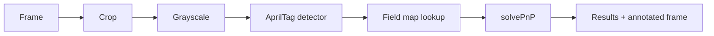

# Apriltag Pipeline

## What are AprilTags?

AprilTags are square fiducial markers with a unique black-and-white pattern. Each tag has an ID, so a camera can tell exactly which tag it is looking at. Unlike QR codes, AprilTags are designed for robotics, where fast detection and precise 3D pose estimates matter.

In FRC, AprilTags are fixed to the field. If the robot knows where each tag is, and sees one or more tags, it can estimate its own position.

Common uses:

- Robot localization and pose estimation.
- Aiming at a scoring location.
- Measuring distance and angle to a target.
- Aligning to a field element.

## How the pipeline works

For every frame, `ApriltagPipeline`:

1. Applies the configured crop region.
2. Converts the image to grayscale.
3. Runs the AprilTag detector to find tag corners and IDs.
4. Looks up each tag's known field pose in `deploy/fmap.json`.
5. Uses solvePnP with the camera matrix, distortion coefficients, and tag size to estimate the camera pose in field coordinates.
6. Draws detection markers on the output frame.
7. Publishes results and auxiliary values.



## What you need

### 1. Camera calibration

Calibrate the camera at the resolution the pipeline uses. Without calibration, pose estimates will be inaccurate, especially near the edges of the image.

See [Camera Calibration](../../../getting-started/quick-start/camera-calibration.md).

### 2. A field map

The pipeline loads `deploy/fmap.json` from your project. The file lists every tag's field pose:

```json
{
  "tags": [
    {
      "ID": 1,
      "pose": {
        "translation": { "x": 11.8779798, "y": 7.4247756, "z": 0.889 },
        "rotation": {
          "quaternion": { "W": 0.0, "X": 0.0, "Y": 0.0, "Z": 1.0 }
        }
      }
    }
  ],
  "field": {
    "length": 16.541,
    "width": 8.069
  }
}
```

- `ID` is the AprilTag ID.
- `translation` is in meters in WPILib field coordinates.
- `rotation.quaternion` is the tag's orientation in field coordinates.
- `field.length` and `field.width` are in meters.

Place the file at:

```text
<project>/deploy/fmap.json
```

The pipeline loads it when the pipeline is created. If the file is missing, the pipeline raises an error.


The `examples/synapseproject` folder in the Synapse repository contains a complete field map you can copy as a starting point.


### 3. Correct tag size

Set **Tag Size** to the physical width of the printed tag in meters. The official FRC tags are `0.1651 m` (6.5 in). Measure the black-and-white tag itself, not the backing material.

## Add the pipeline

1. Open the dashboard.
2. Select a camera.
3. Press **Add Pipeline**.
4. Choose **ApriltagPipeline**.
5. Give it a name and press **Add Pipeline**.
6. Select it from the pipeline dropdown.

See [Pipeline Settings](../../built-in-pipelines-1/pipeline-settings.md) for the dashboard controls.

## Results

When the pipeline has detected at least one tag, the runtime publishes:

| Data | Where | Description |
| --- | --- | --- |
| `hasResults` | `<camera>/data/hasResults` | `true` after the first detection, `false` when tags are lost |
| `tag_id` | `<camera>/data/tag_id` | ID of the most recently detected tag |
| `results` | `<camera>/data/results` | MessagePack-encoded final result |

The final result contains:

| Key | Type | Description |
| --- | --- | --- |
| `cameraEstimate_fieldSpace` | `[x, y, z, roll, pitch, yaw]` | Estimated camera pose in field coordinates (meters, degrees) |
| `tags` | array | One entry per detected tag |
| `tags[].tag_id` | int | AprilTag ID |
| `tags[].hamming` | float | Hamming distance of the decoded tag |
| `tags[].tagPose_screenSpace` | `[x, y]` | Tag center in image pixels |
| `reprojection_error` | float | Error of the pose fit; lower is better |

In Java, `ApriltagResult.cameraEstimate_fieldSpace3d()` converts the pose array to a `Pose3d`. In Python, `ApriltagResult.cameraEstimate_fieldSpace3d` is a property that does the same.

Read them from robot code with [SynapseLib](../../../robot-interfacing/synapse-bridge/getting-target-data.md), or inspect them in the dashboard's **Results** panel.

## Coordinate systems

- **Field space** — WPILib field coordinates, origin at the field's corner, meters.
- **Screen space** — pixel coordinates in the camera image.
- **Camera pose** — the pose of the camera in field space.

The camera is not the robot. To get the robot pose, apply the robot-to-camera transform. See [Robot Pose](../../../robot-interfacing/synapse-bridge/robot-pose.md).

## Important behavior

- **`publish_camera_field_pose` should stay `True`.** The pipeline currently serializes the camera estimate unconditionally when tags are present. Disabling pose estimation can cause a serialization error.
- **`publish_tag_pose_3d` and `verbosity` are defined but not currently used** by the result serializer. They are reserved for future use.
- **Tags not in `fmap.json` are ignored** with a warning.
- **Results are cleared** when no tags are visible.

## Tuning

Start with the defaults, then change one setting at a time. The full reference is in [ApriltagPipeline Settings](apriltagpipeline-settings.md).

Common adjustments:

| Problem | Try |
| --- | --- |
| Detection is too slow | Crop the image, raise `quad_decimate`, lower resolution, increase `num_threads` |
| Tags are missed at long range | Lower `quad_decimate`, increase resolution, check lighting and focus |
| Pose is jittery | Calibrate the camera, enable `refine_edges`, check tag size, lock exposure |
| Pose is inaccurate | Verify calibration resolution and tag size, set `quad_decimate` to `1.0`, improve lighting |
| False detections | Raise `min_white_black_diff`, lower `max_line_fit_mse`, use `tag36h11` |

## Next steps

- [ApriltagPipeline Settings](apriltagpipeline-settings.md)
- [Camera Calibration](../../../getting-started/quick-start/camera-calibration.md)
- [Getting Target Data](../../../robot-interfacing/synapse-bridge/getting-target-data.md)
- [Robot Pose](../../../robot-interfacing/synapse-bridge/robot-pose.md)
