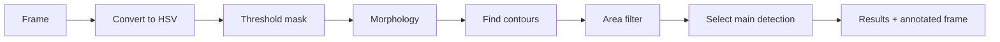

# Color Detection Pipeline

The color pipeline finds regions of an image that fall inside a configurable HSV color range. It reports bounding boxes, centers, and areas, and draws boxes on the output frame.

It is useful for:

- Detecting colored game pieces.
- Aiming at a colored target.
- Line following.
- Simple object tracking.

The pipeline class is `ColorPipeline` and its settings class is `ColorDetectSettings`.

## How it works

For each frame, the pipeline:

1. Converts the image from BGR to HSV.
2. Builds a binary mask with `cv2.inRange`.
3. Applies morphological opening and closing to remove noise and fill gaps.
4. Finds external contours.
5. Filters out contours smaller than **Min Area**.
6. Selects a main detection using the configured strategy.
7. Draws the main detection in green and other detections in red.
8. Publishes the result.



## Add the pipeline

1. Open the dashboard.
2. Select a camera.
3. Press **Add Pipeline**.
4. Choose **ColorPipeline**.
5. Name it and press **Add Pipeline**.
6. Select it from the pipeline dropdown.

## Settings

### H (Hue)

**Type:** Range\
**Default:** `[0, 120]`\
**Range:** `0`–`179`

The lower and upper hue bounds, using OpenCV's hue scale.

OpenCV stores hue in `0–179` instead of `0–360`. To convert a standard hue angle, divide it by two. For example, pure red is around `0` or `179`, green is around `60`, and blue is around `120`.

The pipeline uses the **minimum** value of the range as the lower bound and the **maximum** value as the upper bound.


Red wraps around the hue scale. A single range cannot cover both ends. To detect red, create two color pipelines: one with hue around `0–10`, and one with hue around `170–179`.


### S (Saturation)

**Type:** Range\
**Default:** `[0, 100]`\
**Range:** `0`–`255`

The lower and upper saturation bounds.

Low saturation means the color is close to gray. Raise the lower bound to ignore white/gray objects. Lower it to detect pale colors.

### V (Value / Brightness)

**Type:** Range\
**Default:** `[100, 255]`\
**Range:** `0`–`255`

The lower and upper brightness bounds.

Raise the lower bound to ignore shadows and dark objects. Lower it to detect objects in dim lighting.

### Morph Kernel

**Type:** Integer\
**Default:** `5`\
**Range:** `1`–`20`

The size of the elliptical kernel used for morphological opening and closing.

- A larger kernel removes more noise and fills more gaps, but can merge nearby objects or erase small targets.
- A smaller kernel preserves detail but leaves more noise.

Use an odd number for predictable results.

### Min Area

**Type:** Number\
**Default:** `500`\
**Range:** `0` and up

The minimum contour area, in square pixels, for a detection to count.

Raise it to ignore small specks. Lower it to detect small or distant objects.

### Result Strategy

**Type:** Enum\
**Default:** `largest_area`\
**Options:**

| Value | Behavior |
| --- | --- |
| `largest_area` | Picks the detection with the largest area |
| `closest_to_center` | Picks the detection nearest the image center |
| `first_detected` | Picks the first contour returned by OpenCV |

Use `largest_area` when the biggest object is the target. Use `closest_to_center` when the robot is aiming at the object in the middle of the frame.

### Publish All Detections

**Type:** Boolean\
**Default:** `True`

When `True`, every detection is published and drawn. When `False`, only the main detection is published and drawn.

Disabling it reduces bandwidth and UI clutter when you only care about one target.

## Results

The pipeline publishes final results to `<camera>/data/results` as MessagePack.

The decoded result contains:

| Key | Type | Description |
| --- | --- | --- |
| `timestamp` | float | Time the frame was processed, in seconds |
| `detections` | array | All published detections |
| `main_detection` | object or null | The selected detection |
| `detections[].bbox` | `[x, y, w, h]` | Bounding box in pixels |
| `detections[].center` | `[x, y]` | Center of the detection in pixels |
| `detections[].area` | float | Contour area in square pixels |

The origin `(0, 0)` is the top-left corner of the image.

### Java

```java
Optional<ColorResult> result = camera.getResults(SynapsePipelineType.kColor);
result.ifPresent(r -> {
    if (r.main_detection != null) {
        double centerX = r.main_detection.center[0];
        double area = r.main_detection.area;
    }
});
```

### Python

```python
from synapselib.pipelines.color import ColorResult

raw = camera.getResultsEntry().getRaw(b"")
if raw:
    result = camera.getResults(ColorResult, raw)
    if result.main_detection is not None:
        print(result.main_detection.center, result.main_detection.area)
```

See [Getting Target Data](../../robot-interfacing/synapse-bridge/getting-target-data.md) for the full result-reading API.

## Tuning workflow

Color thresholds depend heavily on lighting, camera exposure, and the object itself. Expect to retune when the venue lighting changes.

1. Set **Min Area** low so you can see all candidates.
2. Start with a wide HSV range and narrow it.
3. Watch the annotated stream:
   - Green box = main detection.
   - Red boxes = other detections.
4. Raise **S** and **V** lower bounds until background objects disappear.
5. Adjust **H** until only the target color remains.
6. Increase **Morph Kernel** if the mask is noisy.
7. Increase **Min Area** to ignore small false positives.
8. Lock camera exposure so the thresholds stay valid.


If the target is white, gray, or black, HSV thresholding is usually a poor fit. Use a custom pipeline with a different method instead.


## Limitations

- A single hue range cannot cover colors that wrap around red.
- Reflections, screens, and colored lighting can create false detections.
- Two objects of the same color cannot be distinguished without additional logic.
- The pipeline does not estimate 3D position. It only reports pixel coordinates.

For 3D position, combine color detection with a known camera geometry in a custom pipeline, or use AprilTags.

## Next steps

- [Custom Pipelines](../custom-pipelines/README.md)
- [Sending Results](../custom-pipelines/sending-results.md)
- [Getting Target Data](../../robot-interfacing/synapse-bridge/getting-target-data.md)
- [Pipeline Settings](../built-in-pipelines-1/pipeline-settings.md)
