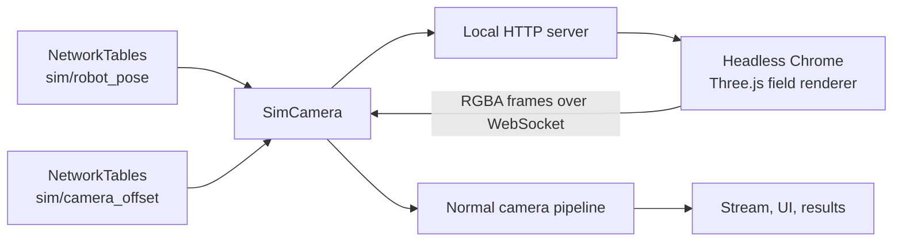

# Simulation

Synapse includes simulated cameras that render a 3D model of the FRC field. The renderer runs in headless Chrome, so pipelines receive realistic frames of AprilTags and field elements without a physical camera.

Simulation is useful for:

- Testing AprilTag detection and pose estimation before you have a robot.
- Developing pipelines on your laptop.
- Recording demo footage or screenshots for your team.

## Requirements

- A Synapse project (see [Project Management](project-management/README.md)).
- Python 3.11–3.14 with `synapsefrc` installed.
- **Chrome or Chromium** installed on the same computer.
- A GPU or a working software renderer. The default backend is Vulkan through ANGLE.

The simulator bundle (`synapse_sim`) is included in the `synapsefrc` package.

## Run the simulation

From your project folder:

```bash
python main.py --sim --server
```

Then open the dashboard:

```text
http://localhost:3000
```

`--sim` makes the runtime use simulated cameras. `--server` starts a local NetworkTables server so the simulation runs on its own.


Without `--server`, `--sim` connects to an existing NetworkTables server at `127.0.0.1`. That is what you want when you run the WPILib robot simulation, which hosts the server itself.


## What gets simulated

- Every configured camera becomes a `SimCamera`. A default camera is created if the project has none.
- Each camera renders from the field model and sees the field's AprilTags.
- The camera projection matches a 70° horizontal field of view.
- Calibration data is generated automatically for every supported resolution, so pose estimation works without calibrating.

Supported resolutions:

```text
1920x1080  1640x1232  1296x972  1280x960  1280x720
1024x768   800x600    640x480   640x360   320x240   320x180
```

## Control the simulated robot

The simulated poses are read from NetworkTables under the Synapse table:

```text
<networktable>/sim/robot_pose
<networktable>/sim/camera_offset
<networktable>/sim/camera_pose
```

With the default NetworkTables name `Synapse`, the full keys are:

```text
Synapse/sim/robot_pose
Synapse/sim/camera_offset
Synapse/sim/camera_pose
```

| Key | Type | Format | Meaning |
| --- | --- | --- | --- |
| `robot_pose` | `double[]` | `[x, y, yaw]` | Robot pose on the field, in meters and radians |
| `camera_offset` | `double[]` | `[x, y, z, roll, pitch, yaw]` | Camera transform relative to the robot |
| `camera_pose` | `double[]` | `[x, y, z, roll, pitch, yaw]` | Optional absolute camera pose. Overrides the robot pose plus offset. |

Defaults:

| Key | Default |
| --- | --- |
| `robot_pose` | `[9.0, 4.2, 0.0]` |
| `camera_offset` | `[0.35, 0.0, 1.4, 0.0, 0.349, 0.0]` (20° pitch) |
| `camera_pose` | empty (not used) |

Write these values from a dashboard, a NetworkTables client, or WPILib simulation code. The rendered view updates as the values change.

### Per-camera overrides

For multi-camera projects, you can give each camera its own pose under:

```text
<networktable>/sim/cameras/<index>/robot_pose
<networktable>/sim/cameras/<index>/camera_offset
<networktable>/sim/cameras/<index>/camera_pose
```

Per-camera values take precedence over the shared values. Empty entries are ignored, so you only need to set the cameras you want to override.

## Configuration

The simulator reads a few environment variables:

| Variable | Default | Purpose |
| --- | --- | --- |
| `SYNAPSE_CHROME` | auto-detected | Path to the Chrome or Chromium executable |
| `CHROME_PATH` | auto-detected | Fallback path to Chrome |
| `SYNAPSE_SIM_ANGLE` | `vulkan` | ANGLE rendering backend |
| `SYNAPSE_SIM_DEBUG` | unset | Enable simulator debug logging |

If Chrome is not found automatically, set `SYNAPSE_CHROME`:

```bash
export SYNAPSE_CHROME=/usr/bin/google-chrome
python main.py --sim --server
```

If the renderer fails to start, try a different ANGLE backend:

```bash
SYNAPSE_SIM_ANGLE=gl python main.py --sim --server
```


On a headless Linux machine, make sure Chrome can run without an X server. Modern Chrome supports headless mode, but some minimal distributions still need `libgl1`, `libegl1`, and Vulkan drivers installed.


## How it works



1. `SimCamera` reads the current pose from NetworkTables.
2. It sends the camera pose to a local render server.
3. Headless Chrome renders the field and streams raw RGBA frames back.
4. `SimCamera` converts the frames to BGR and hands them to the normal camera path.
5. Pipelines, streaming, and results behave exactly as they do with a real camera.

The simulation caps rendering at 120 FPS. It is bounded by the GPU, Chrome, and the rest of the runtime.

## Limits

- The simulation renders the bundled field model; it does not build the scene from your project's `fmap.json`. The AprilTag pipeline still loads tag poses from `deploy/fmap.json`, so add a field map to the project before using AprilTag detection. See [AprilTag Pipeline](built-in-pipelines/apriltag-pipeline/README.md#2-a-field-map).
- Camera noise, motion blur, exposure, and lens distortion are not simulated.
- Simulated calibration assumes no distortion.
- Simulation is for development. It is not a substitute for testing on the real robot and field lighting.

## Next steps

- [Working Without a Robot](working-without-a-robot.md)
- [AprilTag Pipeline](built-in-pipelines/apriltag-pipeline/README.md)
- [Robot Pose](../robot-interfacing/synapse-bridge/robot-pose.md)
- [Project Management](project-management/README.md)
